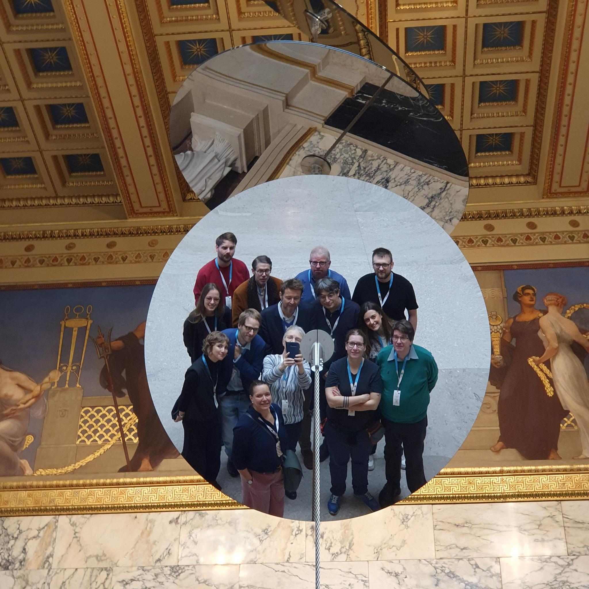

Der Arbeitskreis tagte am 10. und 11. November 2026 in Wien auf Einladung des Institute for Habsburg and Balkan Studies bzw. der [Edition der Ministerratsprotokolle Österreichs und der österreichisch-ungarischen Monarchie](https://www.oeaw.ac.at/ihb/forschungsbereiche/digitale-historiographie-und-editionen/forschung/ministerratsprotokolle-habsburgermonarchie) an der Österreichischen Akademie der Wissenschaften. 

Zum Arbeitskreis hinzugestoßen sind bei diesem Anlass erstmals auch die KollegInnen des Projekts *Die Protokolle des österreichischen Kabinettsrates 1919-1920* ([10.55776/PAT1495024](https://doi.org/10.55776/PAT1495024)). Unter den vielen besprochenen Themen herauszuheben ist die Umstellung vieler Projekte auf die Erzeugung statischer Webseiten ohne Datenbankbackend und die allgegenwärtige Frage nach den Möglichkeiten und Grenzen der mit LLM-gestützten Editionsarbeit.  <!--more-->

Bei einer Exkursion ins österreichische Parlament erhellte nach einer Führung durch das Gebäude auch ein Gespräch mit einer für die [Stenographischen Protokolle](https://www.parlament.gv.at/recherchieren/protokolle/index.html?STENO_211sortrnr=10&STENO_211ascDesc=desc) zuständigen Mitarbeiterin die Umstände, wie Protokolle heutzutage dort verfasst, bearbeitet und überprüft werden. 

Im Rahmenprogramm findet (wegen des Datums besonders passend) auch die Präsentation des Bandes VIII (1914–1918) der Cisleithanischen Ministerratsprotokolle statt: Siehe [hier](/aktuelles/2026/10/14/Praesentation_CMR_VIII_Wien_OeStA/).

